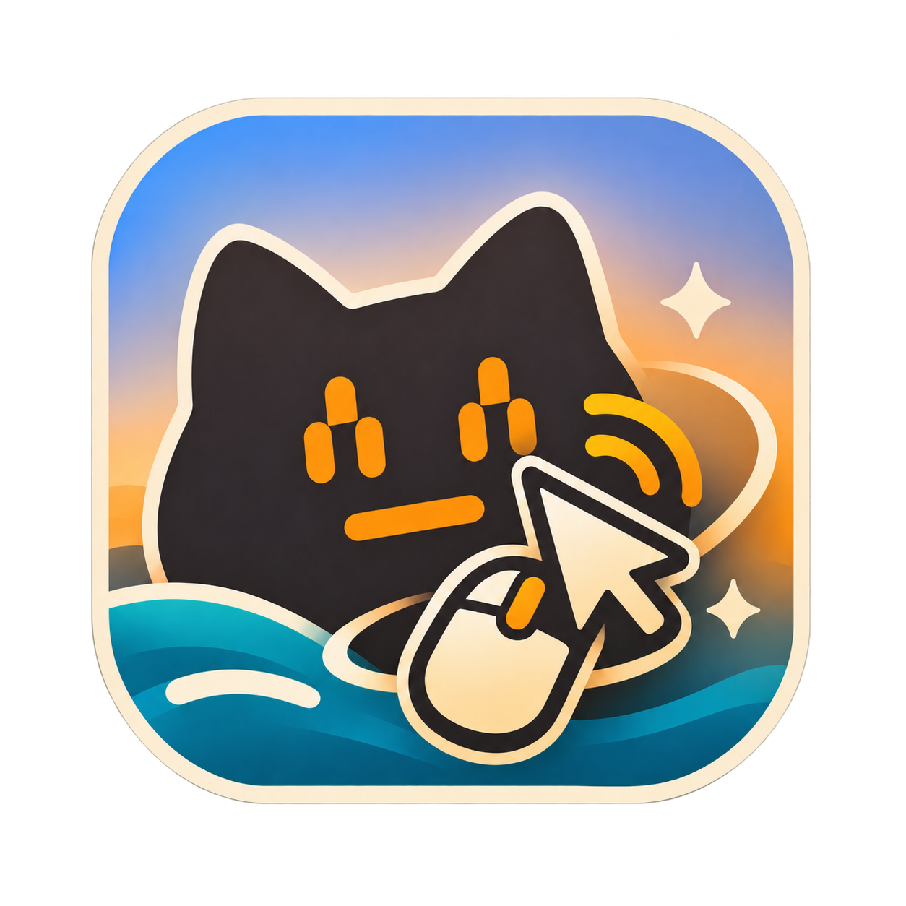
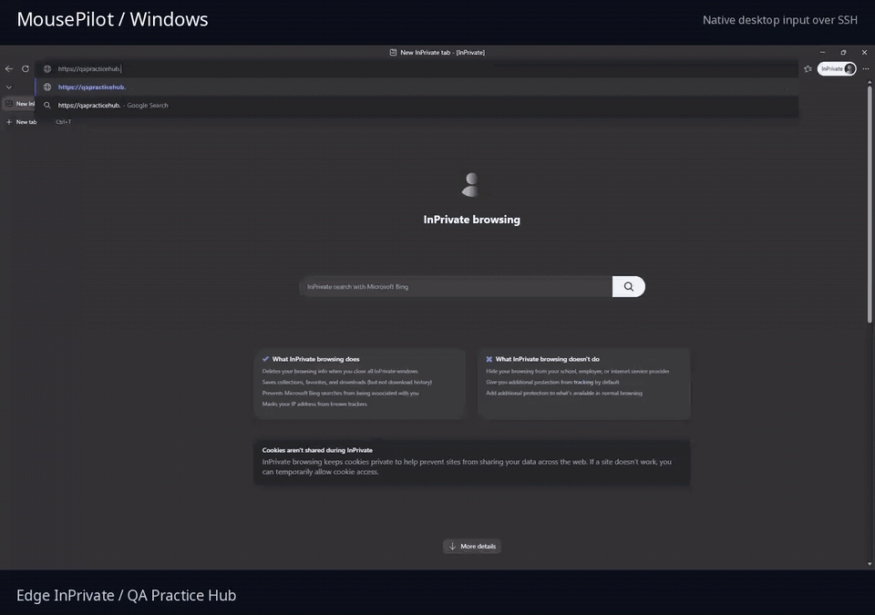
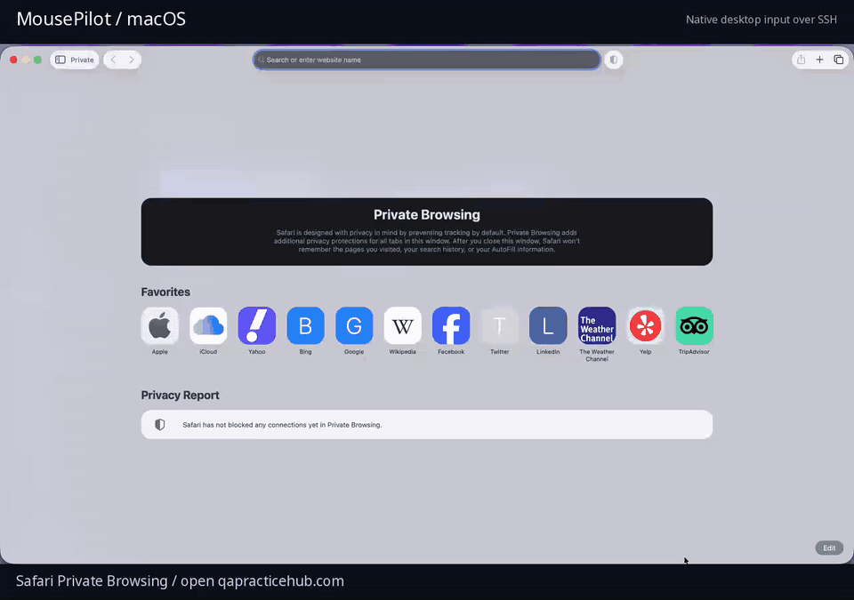

<p align="center">
  
</p>

# MousePilot

<p align="center">
  <strong>Desktop control for your AI agents.</strong><br>
  Use MCP or the CLI to control Windows and macOS 14+.
</p>
<p align="center">
  <a href="CHANGELOG.md">Version 0.1.0b0</a> ·
  <a href="docs/README.md">Documentation</a>
</p>

---

**Contents** · [Demos](#demos) · [Install](#install) · [Use](#use)

## Demos

### Windows · Edge InPrivate

[](docs/assets/windows-demo.mp4)

[Watch the full Windows demo](docs/assets/windows-demo.mp4)

### macOS · Safari Private Browsing

[](docs/assets/macos-demo.mp4)

[Watch the full macOS demo](docs/assets/macos-demo.mp4)

Recorded on [QA Practice Hub](https://qapracticehub.com/): scrolling, typing,
keyboard shortcuts, clicks, and dragging. Silent, with pauses trimmed.

## Install

Install [uv](https://docs.astral.sh/uv/) and download or clone this repository.
Run the backend on the computer you want to control, while logged in and unlocked.

### Windows

From the project folder in PowerShell:

```powershell
uv sync --locked --no-dev
.\.venv\Scripts\mousepilot-server.exe --tray
```

To build a standalone executable instead:

```powershell
.\scripts\build-windows.ps1
.\dist\mousepilot-server.exe --tray
```

### macOS

From the project folder on the Mac:

```sh
./scripts/build-macos.sh
mkdir -p ~/Applications
ditto dist/MousePilot.app ~/Applications/MousePilot.app
open ~/Applications/MousePilot.app
```

In the MousePilot menu, choose **Grant permissions…**. Enable **Accessibility**,
**Input Monitoring**, and **Screen Recording** in Privacy & Security.

## Use

On the computer running your agent (Linux, macOS, or Windows):

```sh
uv sync --locked
```

Follow [configuration](docs/configuration.md) to connect your device over SSH
and add MousePilot to your MCP client.

Ask your agent to take a screenshot, then click, type, scroll, or drag.
Mouse coordinates use the returned image's pixels and its `screenshot_id`.
`type_text` does not press Enter.

For manual control after configuring a device:

```sh
uv run mousepilot --device windows screen
uv run mousepilot --device windows click 640 400 --frame SCREENSHOT_ID
uv run mousepilot --device windows type 'hello'
```

Use `--device mac` for the Mac profile. More commands are in [usage](docs/usage.md).

**Emergency stop:** Ctrl+Alt+Shift+F11 on Windows;
Ctrl+Option+Shift+F11 on macOS. Resume explicitly through MCP or the tray/menu.

## AI-assisted development

AI tools have been used during development.
Contributors remain responsible for reviewing changes and identifying
third-party sources. See [Contributing](CONTRIBUTING.md).

## Updates and contributions

MousePilot is an independent personal project.
Updates follow my needs as I use it. There is no fixed release schedule.
Use the repository's Issues tab to report a bug or request a feature.
Describe the problem and the result you need.
You can also fork the project and submit a pull request.
Feature requests and pull requests do not guarantee an update or acceptance.

See [Contributing](CONTRIBUTING.md) for setup and checks.
